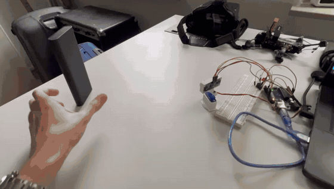
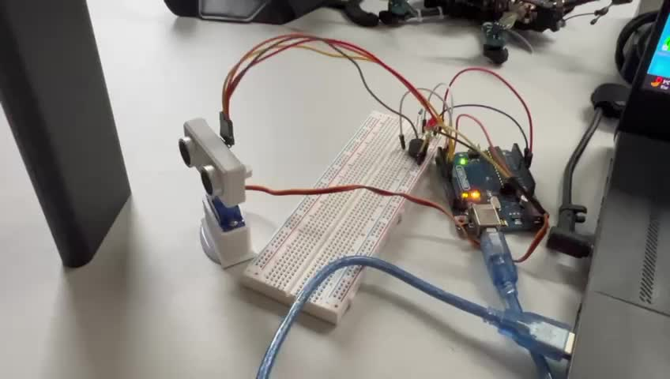
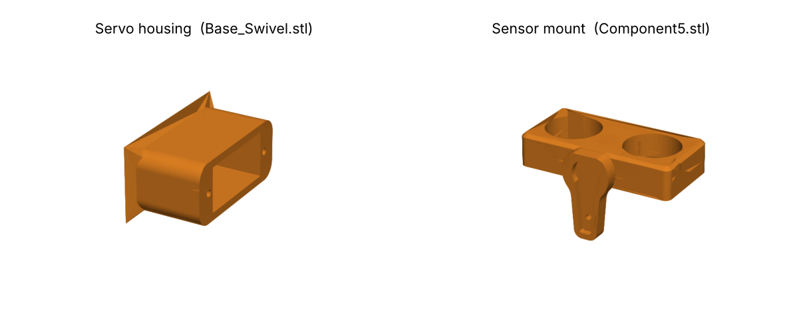
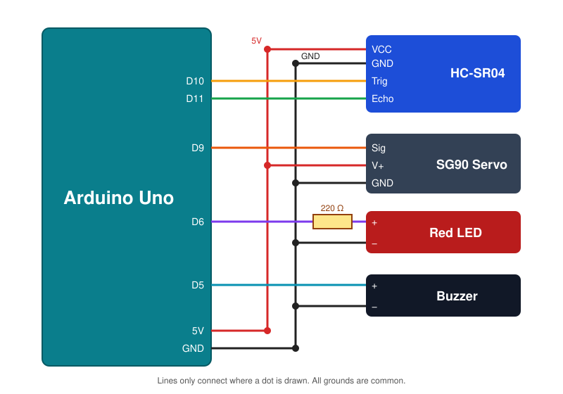
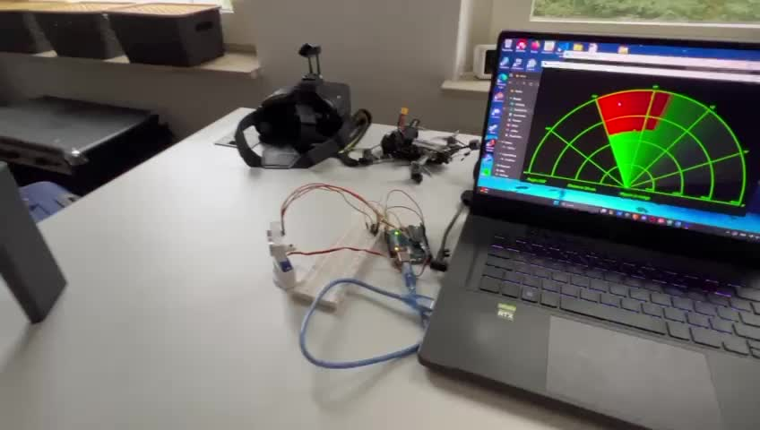

# Arduino Ultrasonic Sonar Radar

A servo-swept ultrasonic "radar" built on an Arduino Uno. An HC-SR04 sensor scans a 150° arc, the distance data is streamed over USB and drawn live as a classic radar screen in [Processing](https://processing.org). When an object comes closer than 20 cm, a red LED blinks and a buzzer beeps — faster the closer it gets.



▶️ **[Watch the full demo video](docs/media/demo.mp4)** (50 s, MP4)

---

## Table of contents

1. [Features](#features)
2. [How it works](#how-it-works)
3. [Bill of materials](#bill-of-materials)
4. [3D-printed parts](#3d-printed-parts)
5. [Mechanical assembly](#mechanical-assembly)
6. [Wiring](#wiring)
7. [Software setup](#software-setup)
8. [Testing and calibration](#testing-and-calibration)
9. [Configuration](#configuration)
10. [Troubleshooting](#troubleshooting)
11. [Repository structure](#repository-structure)
12. [Possible improvements](#possible-improvements)
13. [License](#license)

---

## Features

- 15°–165° sweep with 1° resolution
- Distance measurement with median-of-3 filtering to reject false echoes
- Proximity alarm (LED + buzzer) with distance-dependent beep rate and 2-step confirmation
- Live radar visualisation with fading sweep trail, range rings, angle markings and status bar
- 3D-printed servo housing and sensor mount
- Simple serial protocol (`angle,distance\n`) — easy to reuse with other front ends

## How it works



The servo turns the sensor one degree at a time. After each step the HC-SR04 sends three 40 kHz ultrasonic pings. For each ping the Arduino measures the echo time $t$ and converts it to distance:

$$d = \frac{c \cdot t}{2} \approx \frac{t\,[\mu s]}{58}\ \text{cm}, \qquad c \approx 343\ \text{m/s}$$

The factor 2 is there because the sound travels to the object and back. The median of the three readings is used, and values outside 3–400 cm are discarded.

After every step the Arduino sends one line over USB serial (9600 baud):

```
<angle>,<distance_cm>
```

`distance_cm = 0` means "nothing detected". The Processing sketch reads these lines, converts each angle/distance pair from polar to screen coordinates and draws it on the radar.

If two consecutive steps detect something closer than 20 cm, the alarm triggers. The LED/buzzer toggle interval scales linearly from 300 ms (at 20 cm) down to 50 ms (at 2 cm), and the alarm is held for 600 ms after the last detection so it doesn't flicker while the sensor sweeps past an object.

## Bill of materials

| Qty | Part | Notes |
|---|---|---|
| 1 | Arduino Uno (or compatible clone) | Clones with a CH340 USB chip need the CH340 driver on Windows |
| 1 | USB A-to-B cable | Must be a data cable, not charge-only |
| 1 | HC-SR04 ultrasonic distance sensor | 5 V version |
| 1 | SG90 micro servo (9 g) | Comes with horns and screws |
| 1 | Red LED, 5 mm | |
| 1 | 220 Ω resistor | Current limiter for the LED (anything 220–330 Ω works) |
| 1 | Buzzer, 5 V | Passive or active — see [Configuration](#configuration) |
| 1 | 100–470 µF electrolytic capacitor, ≥ 10 V | Recommended: stops servo current spikes from resetting the Uno |
| 1 | Breadboard (half or full size) | |
| ~15 | Jumper wires | Male-to-male for the breadboard, 4 × female-to-male for the HC-SR04 |
| 1 | Servo housing — `Base_Swivel.stl` | 3D-printed |
| 1 | Sensor mount — `Component5.stl` | 3D-printed |

**Tools:** 3D printer (or a printing service), small Phillips screwdriver, computer with USB. Optional: hot glue gun. No soldering required.

## 3D-printed parts



| File | Part | Size (mm) |
|---|---|---|
| [`hardware/Base_Swivel.stl`](hardware/Base_Swivel.stl) | Servo housing — the SG90 sits inside, the flange is the base | 19.3 × 40.3 × 20.0 |
| [`hardware/Component5.stl`](hardware/Component5.stl) | Sensor mount — holds the HC-SR04, the arm attaches to the servo horn | 48.5 × 27.6 × 26.1 |

**Print settings used** (both parts in one job, sliced with PrusaSlicer 2.9.6):

| Setting | Value |
|---|---|
| Printer | Creality Ender-3, 0.4 mm nozzle |
| Material | PLA |
| Layer height | 0.08 mm (first layer 0.2 mm) |
| Perimeters | 3 |
| Infill | 15 % grid |
| Supports | Only where manually placed (no auto supports) |
| Temperature | 200 °C nozzle (205 °C first layer), 60 °C bed |
| Print time | ≈ 3 h 53 min |
| Filament | ≈ 12.7 g (4.24 m) |

The ready-sliced file is [`hardware/gcode/Sonar_Ender3_PLA.gcode`](hardware/gcode/Sonar_Ender3_PLA.gcode). It only works on an Ender-3 (or a printer with the same bed size and Marlin firmware) — for any other printer, slice the STLs yourself. The 0.08 mm layer height gives a very clean surface; 0.2 mm works too and prints in roughly a third of the time.

## Mechanical assembly

1. **Print both parts** and remove any support material and stringing. Check that the two round openings of the sensor mount are clean so the sensor fits.
2. **Center the servo first.** Connect the servo to the Arduino (signal → D9, red → 5V, brown → GND) and upload [`arduino/servo_center/servo_center.ino`](arduino/servo_center/servo_center.ino). The servo moves to 90° and stays there. Leave it powered for the next steps. This makes sure the sensor faces straight ahead in the middle of the sweep.
3. **Mount the servo in the housing.** Slide the SG90 into `Base_Swivel` with the output shaft at the open end, and lead the cable out of the housing. Fix it with the two screws that came with the servo through the mounting tabs, or with a drop of hot glue.
4. **Fit the sensor into the mount.** Push the HC-SR04 into `Component5` from the back so the two silver transducers sit in the round openings and the pins point away from the front. If it's loose, add a small dot of hot glue on the PCB edge (not on the transducers).
5. **Attach the servo horn to the mount.** Fix the single-arm servo horn to the arm of the sensor mount (small horn screw or a little glue).
6. **Put the mount on the servo.** While the servo is still held at 90° by the centering sketch, press the horn onto the shaft so the sensor faces straight forward, then tighten the center screw of the horn.
7. **Place the base** on a flat surface, ideally slightly raised, so the ultrasonic beam doesn't hit the table (see [Troubleshooting](#troubleshooting)).

## Wiring



### Connection table

| Component | Component pin | Arduino pin | Wire tip |
|---|---|---|---|
| Servo SG90 | Signal (orange/yellow) | **D9** | |
| | V+ (red) | **5V** (via breadboard + rail) | |
| | GND (brown/black) | **GND** (via breadboard − rail) | |
| HC-SR04 | VCC | **5V** (+ rail) | |
| | Trig | **D10** | |
| | Echo | **D11** | |
| | GND | **GND** (− rail) | |
| Red LED | Anode (+, long leg) | **D6** through the 220 Ω resistor | Resistor between D6 and the anode |
| | Cathode (−, short leg, flat side) | **GND** (− rail) | |
| Buzzer | + (long leg / marked +) | **D5** | |
| | − | **GND** (− rail) | |
| Capacitor | + (long leg) | **5V** (+ rail), next to the servo | Mind the polarity |
| | − (stripe side) | **GND** (− rail) | |

### Step by step on the breadboard

1. **Power rails:** connect Arduino **5V** to the breadboard's red (+) rail and Arduino **GND** to the blue (−) rail. Every component gets power from these rails, so all grounds are common.
2. **Servo:** plug the servo connector into three jumper wires: red → + rail, brown → − rail, orange → **D9**.
3. **Capacitor:** place the electrolytic capacitor across the + and − rails close to where the servo is powered. The long leg (+) goes to +, the striped side (−) to −. A reversed electrolytic capacitor can get damaged.
4. **HC-SR04:** use four female-to-male jumpers so the sensor can rotate freely: VCC → + rail, GND → − rail, Trig → **D10**, Echo → **D11**. Leave enough slack in the wires for the full 150° sweep.
5. **LED:** put the LED into the breadboard. Connect **D6** → 220 Ω resistor → LED long leg; LED short leg → − rail.
6. **Buzzer:** buzzer + → **D5**, buzzer − → − rail.
7. **Double-check** before plugging in USB: no wire from 5V directly to GND, LED and capacitor the right way round, Trig and Echo not swapped.

> **Power note:** the SG90 can draw several hundred mA when it starts moving. Powered from the Uno's 5V pin over USB this works with the capacitor in place. If the Uno still resets or the servo jitters, power the servo from a separate 5 V supply and connect that supply's GND to the Arduino GND.

## Software setup

### 1. Install the tools

- [Arduino IDE](https://www.arduino.cc/en/software) (the Servo library is included)
- [Processing 4](https://processing.org/download) (the Serial library is included)
- Windows with a clone Uno: the CH340 USB driver, if the board isn't recognised

### 2. Upload the firmware

1. Download or clone this repository.
2. Open [`arduino/sonar_radar/sonar_radar.ino`](arduino/sonar_radar/sonar_radar.ino) in the Arduino IDE.
3. **Tools → Board → Arduino Uno**, then **Tools → Port** → the port of your Uno (`COMx` on Windows, `/dev/ttyACM0` on Linux, `/dev/cu.usbmodem…` on macOS).
4. Click **Upload**. The servo starts sweeping.

### 3. Run the radar display

1. **Close the Arduino Serial Monitor/Plotter** — only one program can use the serial port.
2. Open [`processing/sonar_display/sonar_display.pde`](processing/sonar_display/sonar_display.pde) in Processing and click **Run**.
3. The console at the bottom lists the available ports (`[0] COM3`, `[1] COM4`, …). If the radar doesn't move, set `PORT_INDEX` at the top of the sketch to the index of your Arduino's port and run it again.



## Testing and calibration

1. **Serial check:** before starting Processing, open the Serial Monitor at 9600 baud. You should see lines like `92,34`.
2. **Distance check:** put a flat object (a book or box) exactly 10 cm and 30 cm in front of the sensor and compare with the readings. The HC-SR04 is typically accurate to about ±1 cm in this range.
3. **Alarm check:** move your hand to about 10 cm in front of the sensor — the LED should blink and the buzzer should beep, faster as you get closer.
4. **Direction check:** an object on the right side should appear on the right of the radar. If it's mirrored, the servo horn is mounted the other way round — remove it, rotate it 180° and re-center with the centering sketch.

## Configuration

All settings are constants at the top of the sketches.

| Setting | File | Default | Meaning |
|---|---|---|---|
| `BUZZER_PASSIVE` | `.ino` | `1` | `1` = passive buzzer (driven with `tone()`), `0` = active buzzer (beeps by itself on DC). Test: if the buzzer beeps when connected directly to 5 V, it's active. |
| `ANGLE_MIN` / `ANGLE_MAX` | `.ino` | 15° / 165° | Sweep limits |
| `STEP_DELAY_MS` | `.ino` | 30 ms | Time per 1° step — higher is slower but steadier |
| `ALARM_DIST_CM` | `.ino` | 20 cm | Alarm threshold |
| `ALARM_HOLD_MS` | `.ino` | 600 ms | How long the alarm stays on after the last detection |
| `BUZZ_FREQ_HZ` | `.ino` | 2500 Hz | Buzzer pitch (passive buzzer only) |
| `PORT_INDEX` | `.pde` | `0` | Serial port index from the console list |
| `MAX_RANGE` | `.pde` | 40 cm | Range shown on the radar |
| `ALARM_DIST` | `.pde` | 20 cm | Keep equal to `ALARM_DIST_CM` |

## Troubleshooting

| Problem | Cause / fix |
|---|---|
| Upload fails: `cannot set com-state` / `unable to open port` | Another program has the port open (Serial Monitor, Processing, slicer or configurator tools). Close it, replug USB, reselect the port. Unplug the servo's 5V wire during upload if the board keeps resetting. |
| Board not shown under Tools → Port | Charge-only USB cable, or missing CH340 driver on a clone board. |
| Servo sweeps but the radar stays still | Wrong `PORT_INDEX`, or the Serial Monitor is still open. |
| Phantom objects | The beam (about ±15° wide) hits the table, the wires or the breadboard. Mount the sensor higher, tilt it up slightly, route wires behind it, add the servo capacitor. |
| Distance always 0 | Trig/Echo swapped, or the sensor has no 5 V. |
| Uno resets / servo jitters | Servo current spikes — add the capacitor or use a separate 5 V supply with common GND. |
| Buzzer silent or only clicks | Wrong `BUZZER_PASSIVE` setting for your buzzer type, or polarity reversed. |
| LED never lights | LED reversed (long leg must go to the resistor/D6). |
| Radar image mirrored | Servo horn mounted 180° off — see [Testing and calibration](#testing-and-calibration). |

## Repository structure

```
arduino/
  sonar_radar/sonar_radar.ino          Main firmware (sweep, measurement, alarm, serial output)
  servo_center/servo_center.ino        Helper: moves the servo to 90° for assembly
processing/
  sonar_display/sonar_display.pde      Radar visualisation (Processing 4)
hardware/
  Base_Swivel.stl                      Servo housing
  Component5.stl                       Sensor mount
  gcode/Sonar_Ender3_PLA.gcode         Sliced print file (Ender-3, PLA)
docs/
  wiring.svg                           Wiring diagram
  images/                              Photos, renders and demo GIF
  media/demo.mp4                       Demo video
```

## Possible improvements

- Start/stop button or a serial command to pause the sweep
- Separate power supply for the servo
- 360° scanning with a continuous-rotation mount
- Logging scans to a file to build a simple room map
- Replacing the HC-SR04 with a time-of-flight laser sensor (e.g. VL53L1X) for a narrower beam

## License

[MIT](LICENSE) © 2026 Theodosios Chovardas
